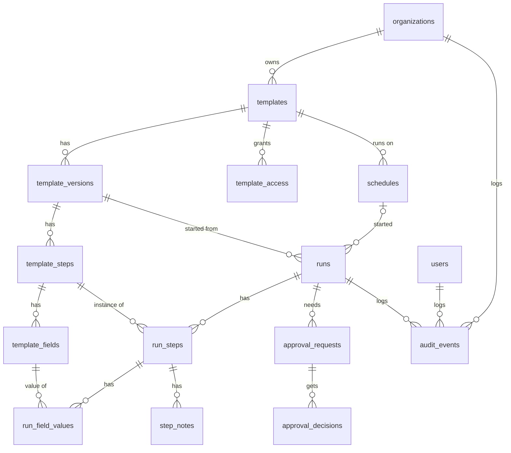

# Plan: database structure

Status: **agreed plan**, ready for the schema to be written. This is a plan, not the schema. Under the [AI use policy](../../AGENTS.md) the data model is written by a person; this doc is the input to that work.

It covers the [MVP scope](../mvp-scope.md) and leaves room for v1 (proof upload, conditional logic, guest links, webhooks) without building it.

## Principles

- **Every tenant table carries `organization_id`.** Queries always filter on it, and foreign keys between tenant tables include it, so a row can't point at another tenant's data. The exception is links to Better Auth's own tables (`members`, `teams`), which are single-column foreign keys: adding the unique constraints a two-column key needs would be lost whenever Better Auth's schema is regenerated, so the API checks that they belong to the same organization.
- **Organizations are soft-deleted.** Deleting one hides it at once and keeps everything for a grace period, during which it can be restored; a nightly job then hard-deletes it, audit log included. See the [audit log plan](audit-log.md#deleted-organizations).
- **Templates are versioned and published versions are immutable.** A run points at the exact version it started from, which gives the "run snapshot" requirement without copying data.
- **The audit log is append-only.** The app's database role gets no `UPDATE` or `DELETE` on it, and a trigger refuses edits and deletes from anyone else. There are no hash chains (decided); tamper evidence is a future feature.
- **Store facts, derive state where cheap.** For example, a step's `due_at` is stored because the overdue job queries it, but "is the run overdue" is computed.
- **Conventions:** snake_case names, `timestamptz` everywhere, `created_at` and `created_by` on every table, `updated_at` on every table that's edited in place, archive instead of delete for anything a run references.
- **IDs are [TypeIDs](https://github.com/jetify-com/typeid):** a type prefix plus a UUIDv7, such as `run_01jbx…`. Stored as `text`. See [IDs](#ids).
- **Tenant isolation is enforced in the app** for the MVP: every query filters on `organization_id`. Postgres row-level security may be added later, and having the column on every table keeps that option open.

## Areas

### 1. Identity and tenancy (owned by Better Auth)

Generated by Better Auth and its organization plugin, with teams enabled; we don't hand-design these, only configure them.

**Naming:** the UI calls teams **groups**. The database and code keep Better Auth's `team` name, because its API endpoints and types use it (`createTeam`, `teamId`), and `group` is a reserved word in SQL.

| Table | Purpose |
| --- | --- |
| `users`, `sessions`, `accounts`, `verifications` | Core auth. Checklog adds `managed_by_organization_id` to `users` through `additionalFields`; see [Personal and managed accounts](#personal-and-managed-accounts). |
| `organizations` | A tenant. Checklog adds `account_type` (personal or managed, fixed at creation) and, for soft deletion, `deleted_at`, `deleted_by` and `purge_after`, all through Better Auth's `additionalFields`. Better Auth's own (hard) delete is turned off. |
| `members` | User in an organization, with a permission role (owner, admin, member) |
| `invitations` | Pending invites |
| `teams`, `team_members` | Groups of people, used for step assignment and approvals. Shown as **Groups** in the UI. |

#### Personal and managed accounts

Every organization is one of two types, chosen when it's created and fixed after that in the MVP (decided):

- **Personal organizations** have only personal accounts. A personal account belongs to the person: they sign up themselves, can belong to any number of personal organizations, and keep the account if an organization is deleted. `managed_by_organization_id` is null.
- **Managed organizations** have only managed accounts, owners included. A managed account belongs to its organization: `managed_by_organization_id` points at it, with `ON DELETE RESTRICT` so the organization can't be hard-deleted while it still has accounts. It can't join or create any other organization.

People from outside a managed organization, such as auditors or contractors, take part through guest links (v1) rather than accounts.

**Creating a managed organization** is its own sign-up flow: the person enters the organization's name and their work email, and Checklog creates the managed account and the organization together, with them as owner. A personal account can't create a managed organization; someone who has one signs up again with a different email, usually their work address.

**Inviting** follows the organization's type, so there's no choice to get wrong:

- In a personal organization, invitations work as normal and can go to any personal account or new email.
- In a managed organization, accepting an invitation creates a new managed account. Email addresses are unique across Checklog, so an invitation to an email that already has an account (personal or managed elsewhere) is refused with a clear message.

**Enforcement** is one rule, checked by `before` hooks on adding a member, accepting an invitation and creating an organization: an account can only join an organization of its own type, and a managed account only its own organization.

**Not in the MVP:** changing an organization's type. Personal to managed would mean taking over people's own accounts; managed to personal could release accounts to their users, and may come later.

**v1:** verified email domains, sign-in through the organization's own SSO, and SCIM provisioning will also create managed accounts.

What happens to accounts when an organization is deleted is in the [audit log plan](audit-log.md#deleted-organizations): in a managed organization, everyone except owners is blocked from signing in during the grace period, and every account is deleted when the organization is purged. Deleting a personal organization never deletes an account.

### 2. Templates

| Table | Key columns | Notes |
| --- | --- | --- |
| `templates` | `organization_id`, `name`, `description`, `status` (active, archived), `current_version_id` | The stable identity people see and schedule |
| `template_versions` | `template_id`, `version` (1, 2, 3…), `status` (draft, published, archived), `published_at`, `published_by` | At most one draft per template. Published versions never change. Archiving a version stops new runs from it; runs already using it carry on (decided). |
| `template_steps` | `template_version_id`, `position`, `title`, `instructions` (Markdown), `kind` (task, approval), `is_halt`, `skippable`, `assignee_type` (user, team, role), `assignee_ref`, `due_offset` (interval from run start) | `is_halt` blocks later steps until this one is done. `skippable` must be false for halt and approval steps (checked in the API). For an approval step, the assignee is the approver (decided). A `role` assignee is an organization role (owner, admin, member): anyone with that role can act on the step. |
| `template_fields` | `template_step_id`, `position`, `key`, `label`, `type` (text, date, dropdown, checkbox), `required`, `options` (jsonb, dropdown choices) | `key` is stable across versions so values can be compared between runs |
| `template_access` | `organization_id`, `template_id`, `member_id` or `team_id`, `level` (view, run, edit) | Who can see, run or edit a template. Exactly one of `member_id` and `team_id` is set (checked in the API). Grants point at the membership rather than the user, so removing someone from the organization or deleting a group removes their grants (`ON DELETE CASCADE`). Unique on (`template_id`, `member_id`) and (`template_id`, `team_id`). |

Editing a template means editing its draft version; publishing copies nothing, it just freezes the draft and points `current_version_id` at it.

**Permissions:** organization-wide permissions come from the member's Better Auth role (owner, admin, member, plus any custom roles). Access to an individual template comes from `template_access`: each level includes the ones below it (edit includes run, run includes view). Owners and admins can reach every template. A template with no access rows is visible only to them and its creator. All permission checks go through one function in the API, so group-granted roles can be added later without touching callers (see [Leaving room for v1](#leaving-room-for-v1)).

### 3. Schedules

| Table | Key columns | Notes |
| --- | --- | --- |
| `schedules` | `template_id`, `rrule` (RFC 5545), `timezone`, `next_run_at`, `active`, `run_name_pattern`, `created_by` | Covers daily, weekly, monthly and custom. Always uses the template's current version when it fires. |

pg-boss does the firing: a recurring job finds schedules with `next_run_at <= now()`, starts runs and advances `next_run_at`. The `schedules` table stays the source of truth, so the UI can list and edit schedules without reading pg-boss internals.

### 4. Runs

| Table | Key columns | Notes |
| --- | --- | --- |
| `runs` | `organization_id`, `template_version_id`, `schedule_id` (null if ad hoc), `name`, `status` (in progress, completed, cancelled), `started_by`, `started_at`, `completed_at` | |
| `run_steps` | `run_id`, `template_step_id`, `status` (pending, done, skipped), `assignee_user_id`, `assignee_team_id` or `assignee_role`, `due_at`, `completed_by`, `completed_at`, `skip_reason` | One row per template step, created when the run starts. The assignee is copied from the template step at start and can be reassigned. For a skipped step, `completed_by` and `completed_at` record who skipped it and when, and `skip_reason` is required (checked in the API). |
| `run_field_values` | `run_step_id`, `template_field_id`, `value` (jsonb), `updated_by`, `updated_at` | Current value only. Every change is an audit event, and the audit log is the history (decided). |
| `step_notes` | `run_step_id`, `author_id`, `body`, `created_at` | Append-only. Corrections are new notes. |

"Blocked" isn't stored: a step is blocked when an earlier halt step isn't done, which the API works out from the run's steps.

**Skipping:** only steps marked `skippable` in the template version can be skipped, always with a reason. The skip is an audit event and the reason shows on the run. A skipped step counts as resolved, so it doesn't hold up run completion. Approval of skips may come later.

### 5. Approvals

| Table | Key columns | Notes |
| --- | --- | --- |
| `approval_requests` | `run_id`, `run_step_id`, `approver_type` (user, team, role), `approver_ref`, `status` (pending, approved, rejected) | Created when an approval step needs sign-off. Approvals are always on a step; to sign off a whole run, a template puts an approval step last. For an approval step, the approver is the run step's current assignee, copied when the request is created, so reassigning the step before then changes who approves. |
| `approval_decisions` | `approval_request_id`, `decided_by`, `decision`, `comment`, `decided_at` | Separate from the request so a rejection followed by a later approval keeps both |

### 6. Audit log

| Table | Key columns | Notes |
| --- | --- | --- |
| `audit_events` | `scope` (organization, user, platform), `organization_id`, `run_id`, `user_id`, `occurred_at`, `actor_type` (user, system, guest), `actor_id`, `action`, `entity_type`, `entity_id`, `payload` (jsonb), `context` (jsonb) | One table for every event. Organization events (including runs) belong to an organization, user events (sign-ins) to a user, and platform events to the deployment. Foreign keys to organizations, runs and users use `RESTRICT`, so audit history is only ever removed on purpose: when a soft-deleted organization is purged after its grace period. Details in the [audit log plan](audit-log.md). |

Writing an event inserts one row in the same transaction as the change being recorded, so the change and its event either both commit or neither does.

### 7. Notifications

| Table | Key columns | Notes |
| --- | --- | --- |
| `notifications` | `organization_id`, `user_id`, `type` (assigned, overdue, approval needed), `run_step_id` or `approval_request_id`, `sent_at`, `read_at` | Also stops the overdue job emailing the same person twice |

## IDs

Every primary key is a TypeID: a lowercase prefix naming the type, an underscore, and a UUIDv7 encoded in 26 characters of base32. For example `tmpl_01jbxk8m4qe6r9w0c2v3n5t7yz`.

- **Why:** an ID says what it is in logs, URLs and support requests, and passing a run ID where a template ID is expected is caught by the types. The UUIDv7 inside keeps IDs time-ordered, so they sort and index well even as text.
- **Better Auth:** its `advanced.database.generateId` option takes a function that is told which model the ID is for, so Better Auth's own tables get prefixed TypeIDs too (`user_…`, `org_…`, `team_…`). Every ID in the system looks the same.
- **Storage:** `text` columns. A native `uuid` column would be half the size, but then every ID would need converting at the API boundary, and Better Auth's endpoints would return the raw form. At Checklog's scale the extra index size doesn't matter.
- **Generation:** in the app with `typeid-js`, not in Postgres. Each table's `$defaultFn` sets the right prefix; the database doesn't check it, in line with keeping value rules in the API.
- **Prefixes:** short and fixed once chosen, because they are part of every stored ID. The list lives in `src/apps/api/src/util/typeid.ts`: `user`, `sess`, `acct`, `verif`, `org`, `mem`, `inv`, `team`, `tmem`, `tmpl`, `tver`, `tstep`, `tfield`, `tacc`, `sched`, `run`, `rstep`, `fval`, `note`, `apreq`, `apdec`, `aevt`, `notif`.

## Relationships

## Leaving room for v1

None of these are built in the MVP; the plan only makes sure they won't need a redesign.

- **Proof upload:** an `attachments` table keyed to `run_step_id` (and optionally a field), storing the S3 object key, hash and uploader. Its hash goes into the audit event.
- **Conditional logic:** a `template_step_conditions` table referencing a field `key` and the step it shows or hides. Runs then need a `skipped` status, which `run_steps` already has.
- **Guest links:** a `guest_access` table with a hashed token, scope (run or step) and expiry. `actor_type = guest` in the audit log already allows for it.
- **Webhooks:** `webhooks` and `webhook_deliveries` tables, fed from audit events.
- **Linked checklists:** a nullable `parent_run_step_id` on `runs`.
- **Groups grant roles:** a `team_roles` table giving a group one or more roles, with a member's effective permissions being the union of their own role and their groups' roles. Checklog's single permission function takes this on; Better Auth's own checks (organization management) keep using the member's role only.

## Decided

- **Approvers:** the assignee of an approval step is its approver; there are no separate approver columns on template steps
- **No run-level approvals for now:** every approval belongs to an approval step; signing off a run means ending its template with an approval step
- **Timestamps and history:** both (decided). Every table edited in place has `updated_at`, for "last changed" lists and edit-conflict checks (save only if `updated_at` hasn't changed since loading). The audit log is the full history of who changed what. There's no `updated_by`; the audit log covers it. `created_by` isn't a foreign key to `users`, because the purge deletes a managed organization's accounts before its data; rows created by jobs use the job's name.
- **Validation:** the database enforces keys, relationships and uniqueness; value rules such as statuses, which steps can be skippable and required skip reasons are checked in the API
- **Groups:** Better Auth teams, called groups in the UI
- **Permissions:** organization-wide permissions from member roles; per-template access for groups and people through `template_access`. Groups granting roles is planned for later.
- **Skipping steps:** template steps can be marked skippable; skipping needs a reason. Halt and approval steps can't be skipped.
- **Tenant isolation:** in the app for the MVP; row-level security maybe later
- **Field value history:** the audit log is enough
- **Archiving versions:** allowed while runs use them; only new runs are blocked. "Archived" is used for both templates and versions, to keep one word for it.
- **IDs:** TypeIDs (prefix plus UUIDv7), including Better Auth's tables

## Open questions

None at the moment. Add new ones here as the schema is written.

## Suggested order of work

1. Configure Better Auth with the organization plugin and generate its tables
2. The audit log, since every later write records an event
3. Templates, versions, steps, fields and template access
4. Runs, run steps, field values and notes
5. Approvals
6. Schedules and the pg-boss firing job
7. Notifications and the overdue job
