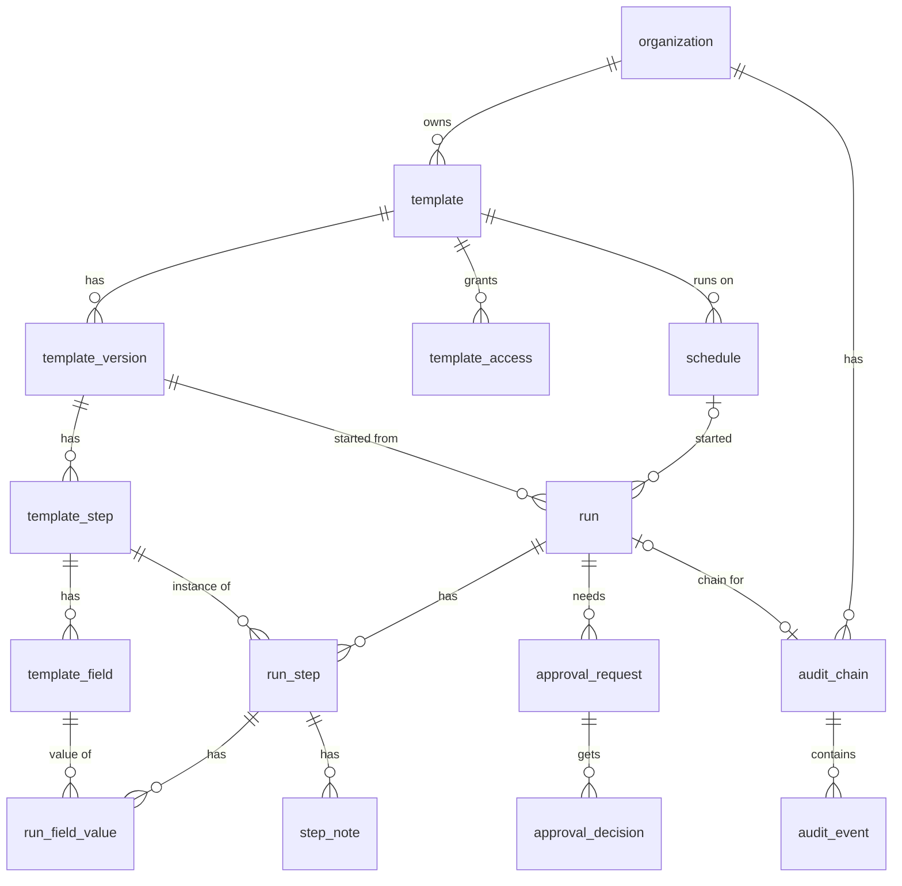

# Plan: database structure

Status: **agreed plan**, ready for the schema to be written. This is a plan, not the schema. Under the [AI use policy](../../AGENTS.md) the data model is written by a person; this doc is the input to that work.

It covers the [MVP scope](../mvp-scope.md) and leaves room for v1 (proof upload, conditional logic, guest links, webhooks) without building it.

## Principles

- **Every tenant table carries `organization_id`.** Queries always filter on it, and foreign keys between tenant tables include it, so a row can't point at another tenant's data.
- **Templates are versioned and published versions are immutable.** A run points at the exact version it started from, which gives the "run snapshot" requirement without copying data.
- **The audit log is append-only and hash-chained.** The app's database role gets no `UPDATE` or `DELETE` on it.
- **Store facts, derive state where cheap.** For example, a step's `due_at` is stored because the overdue job queries it, but "is the run overdue" is computed.
- **Conventions:** snake_case names, `timestamptz` everywhere, `created_at` on every table, archive instead of delete for anything a run references.
- **IDs are [TypeIDs](https://github.com/jetify-com/typeid):** a type prefix plus a UUIDv7, such as `run_01jbx…`. Stored as `text`. See [IDs](#ids).
- **Tenant isolation is enforced in the app** for the MVP: every query filters on `organization_id`. Postgres row-level security may be added later, and having the column on every table keeps that option open.

## Areas

### 1. Identity and tenancy (owned by Better Auth)

Generated by Better Auth and its organization plugin, with teams enabled; we don't hand-design these, only configure them.

**Naming:** the UI calls teams **groups**. The database and code keep Better Auth's `team` name, because its API endpoints and types use it (`createTeam`, `teamId`), and `group` is a reserved word in SQL.

| Table | Purpose |
| --- | --- |
| `user`, `session`, `account`, `verification` | Core auth |
| `organization` | A tenant |
| `member` | User in an organization, with a permission role (owner, admin, member) |
| `invitation` | Pending invites |
| `team`, `team_member` | Groups of people, used for step assignment and approvals. Shown as **Groups** in the UI. |

### 2. Templates

| Table | Key columns | Notes |
| --- | --- | --- |
| `template` | `organization_id`, `name`, `description`, `status` (active, archived), `current_version_id` | The stable identity people see and schedule |
| `template_version` | `template_id`, `version` (1, 2, 3…), `status` (draft, published, retired), `published_at`, `published_by` | At most one draft per template. Published versions never change. Retiring a version stops new runs from it; runs already using it carry on (decided). |
| `template_step` | `template_version_id`, `position`, `title`, `instructions` (Markdown), `kind` (task, approval), `is_halt`, `skippable`, `assignee_type`, `assignee_ref`, `due_offset` (interval from run start) | `is_halt` blocks later steps until this one is done. `skippable` must be false for halt and approval steps (a `CHECK` constraint). |
| `template_field` | `template_step_id`, `position`, `key`, `label`, `type` (text, date, dropdown, checkbox), `required`, `options` (jsonb, dropdown choices) | `key` is stable across versions so values can be compared between runs |
| `template_access` | `organization_id`, `template_id`, `principal_type` (user, team), `principal_id`, `level` (view, run, edit) | Who can see, run or edit a template. Unique on (`template_id`, `principal_type`, `principal_id`). |

Editing a template means editing its draft version; publishing copies nothing, it just freezes the draft and points `current_version_id` at it.

**Permissions:** organization-wide permissions come from the member's Better Auth role (owner, admin, member, plus any custom roles). Access to an individual template comes from `template_access`: each level includes the ones below it (edit includes run, run includes view). Owners and admins can reach every template. A template with no access rows is visible only to them and its creator. All permission checks go through one function in the API, so group-granted roles can be added later without touching callers (see [Leaving room for v1](#leaving-room-for-v1)).

### 3. Schedules

| Table | Key columns | Notes |
| --- | --- | --- |
| `schedule` | `template_id`, `rrule` (RFC 5545), `timezone`, `next_run_at`, `active`, `run_name_pattern`, `created_by` | Covers daily, weekly, monthly and custom. Always uses the template's current version when it fires. |

pg-boss does the firing: a recurring job finds schedules with `next_run_at <= now()`, starts runs and advances `next_run_at`. The `schedule` table stays the source of truth, so the UI can list and edit schedules without reading pg-boss internals.

### 4. Runs

| Table | Key columns | Notes |
| --- | --- | --- |
| `run` | `organization_id`, `template_version_id`, `schedule_id` (null if ad hoc), `name`, `status` (in progress, completed, cancelled), `started_by`, `started_at`, `completed_at` | |
| `run_step` | `run_id`, `template_step_id`, `status` (pending, done, skipped), `assignee_user_id` or `assignee_team_id`, `due_at`, `completed_by`, `completed_at`, `skip_reason` | One row per template step, created when the run starts. Assignee is resolved at start but can be reassigned. For a skipped step, `completed_by` and `completed_at` record who skipped it and when, and `skip_reason` is required (a `CHECK` constraint). |
| `run_field_value` | `run_step_id`, `template_field_id`, `value` (jsonb), `updated_by`, `updated_at` | Current value only. Every change is an audit event, and the audit log is the history (decided). |
| `step_note` | `run_step_id`, `author_id`, `body`, `created_at` | Append-only. Corrections are new notes. |

"Blocked" isn't stored: a step is blocked when an earlier halt step isn't done, which the API works out from the run's steps.

**Skipping:** only steps marked `skippable` in the template version can be skipped, always with a reason. The skip is an audit event and the reason shows on the run. A skipped step counts as resolved, so it doesn't hold up run completion. Approval of skips may come later.

### 5. Approvals

| Table | Key columns | Notes |
| --- | --- | --- |
| `approval_request` | `run_id`, `run_step_id` (null means the whole run), `approver_type` (user, team, role), `approver_ref`, `status` (pending, approved, rejected) | Created when a step or run needs sign-off |
| `approval_decision` | `approval_request_id`, `decided_by`, `decision`, `comment`, `decided_at` | Separate from the request so a rejection followed by a later approval keeps both |

### 6. Audit log

| Table | Key columns | Notes |
| --- | --- | --- |
| `audit_chain` | `organization_id`, `scope` (organization, run), `run_id`, `head_seq`, `head_hash` | One chain per run, plus one per organization for things that aren't run-specific (sign-ins, role changes, template publishes) |
| `audit_event` | `chain_id`, `seq`, `prev_hash`, `hash`, `actor_type` (user, system, guest), `actor_id`, `action`, `entity_type`, `entity_id`, `payload` (jsonb), `occurred_at` | Unique on (`chain_id`, `seq`) so a chain can't fork |

Writing an event: lock the chain row (`SELECT … FOR UPDATE`), compute `hash = sha256(prev_hash + canonical JSON of the event)`, insert the event, update the chain head, all in the same transaction as the change being recorded. Verification replays a chain and recomputes each hash.

### 7. Notifications

| Table | Key columns | Notes |
| --- | --- | --- |
| `notification` | `organization_id`, `user_id`, `type` (assigned, overdue, approval needed), `run_step_id` or `approval_request_id`, `sent_at`, `read_at` | Also stops the overdue job emailing the same person twice |

## IDs

Every primary key is a TypeID: a lowercase prefix naming the type, an underscore, and a UUIDv7 encoded in 26 characters of base32. For example `tmpl_01jbxk8m4qe6r9w0c2v3n5t7yz`.

- **Why:** an ID says what it is in logs, URLs and support requests, and passing a run ID where a template ID is expected is caught by the types. The UUIDv7 inside keeps IDs time-ordered, so they sort and index well even as text.
- **Better Auth:** its `advanced.database.generateId` option takes a function that is told which model the ID is for, so Better Auth's own tables get prefixed TypeIDs too (`user_…`, `org_…`, `team_…`). Every ID in the system looks the same.
- **Storage:** `text` columns. A native `uuid` column would be half the size, but then every ID would need converting at the API boundary, and Better Auth's endpoints would return the raw form. At Checklog's scale the extra index size doesn't matter.
- **Generation:** in the app with `typeid-js`, not in Postgres. A `CHECK` constraint on each table can enforce the prefix.
- **Prefixes:** short and fixed once chosen, because they are part of every stored ID. The list lives in `src/apps/api/src/util/typeid.ts`: `user`, `sess`, `acct`, `verif`, `org`, `mem`, `inv`, `team`, `tmem`, `tmpl`, `tver`, `tstep`, `tfield`, `tacc`, `sched`, `run`, `rstep`, `fval`, `note`, `apreq`, `apdec`, `achain`, `aevt`, `notif`.

## Relationships

## Leaving room for v1

None of these are built in the MVP; the plan only makes sure they won't need a redesign.

- **Proof upload:** an `attachment` table keyed to `run_step_id` (and optionally a field), storing the S3 object key, hash and uploader. Its hash goes into the audit event.
- **Conditional logic:** a `template_step_condition` table referencing a field `key` and the step it shows or hides. Runs then need a `skipped` status, which `run_step` already has.
- **Guest links:** a `guest_access` table with a hashed token, scope (run or step) and expiry. `actor_type = guest` in the audit log already allows for it.
- **Webhooks:** `webhook` and `webhook_delivery` tables, fed from audit events.
- **Linked checklists:** a nullable `parent_run_step_id` on `run`.
- **Groups grant roles:** a `team_role` table giving a group one or more roles, with a member's effective permissions being the union of their own role and their groups' roles. Checklog's single permission function takes this on; Better Auth's own checks (organization management) keep using the member's role only.

## Decided

- **Groups:** Better Auth teams, called groups in the UI
- **Permissions:** organization-wide permissions from member roles; per-template access for groups and people through `template_access`. Groups granting roles is planned for later.
- **Skipping steps:** template steps can be marked skippable; skipping needs a reason. Halt and approval steps can't be skipped.
- **Tenant isolation:** in the app for the MVP; row-level security maybe later
- **Field value history:** the audit log is enough
- **Retiring versions:** allowed while runs use them; only new runs are blocked
- **IDs:** TypeIDs (prefix plus UUIDv7), including Better Auth's tables

## Open questions

None at the moment. Add new ones here as the schema is written.

## Suggested order of work

1. Configure Better Auth with the organization plugin and generate its tables
2. Audit chain and events, since every later write records one
3. Templates, versions, steps, fields and template access
4. Runs, run steps, field values and notes
5. Approvals
6. Schedules and the pg-boss firing job
7. Notifications and the overdue job
